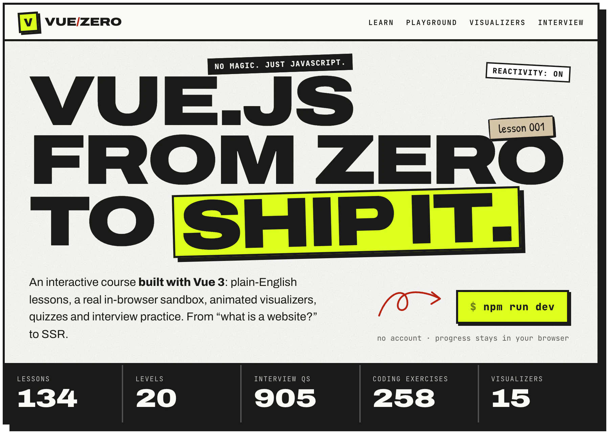
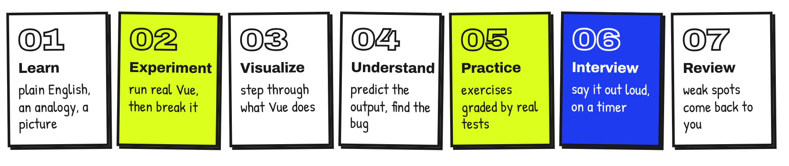
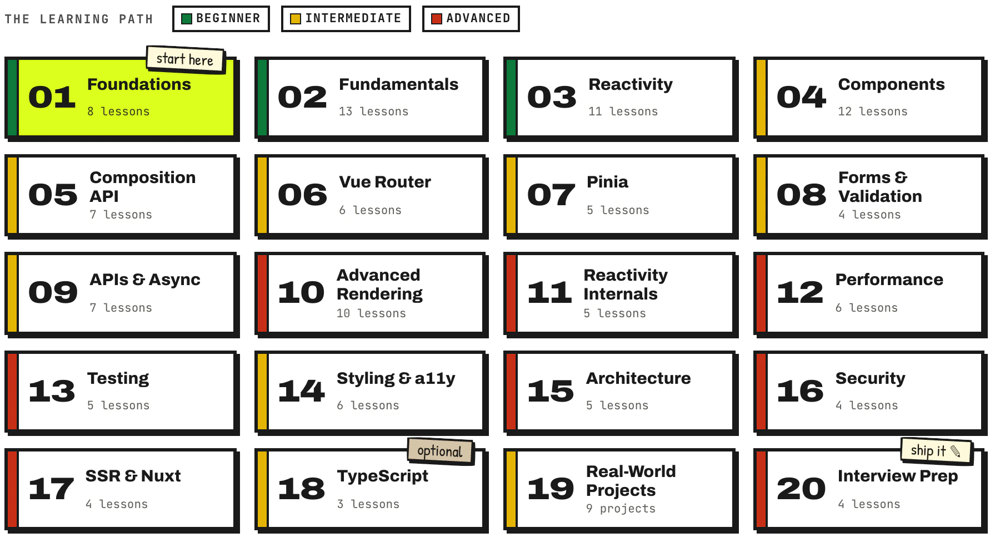
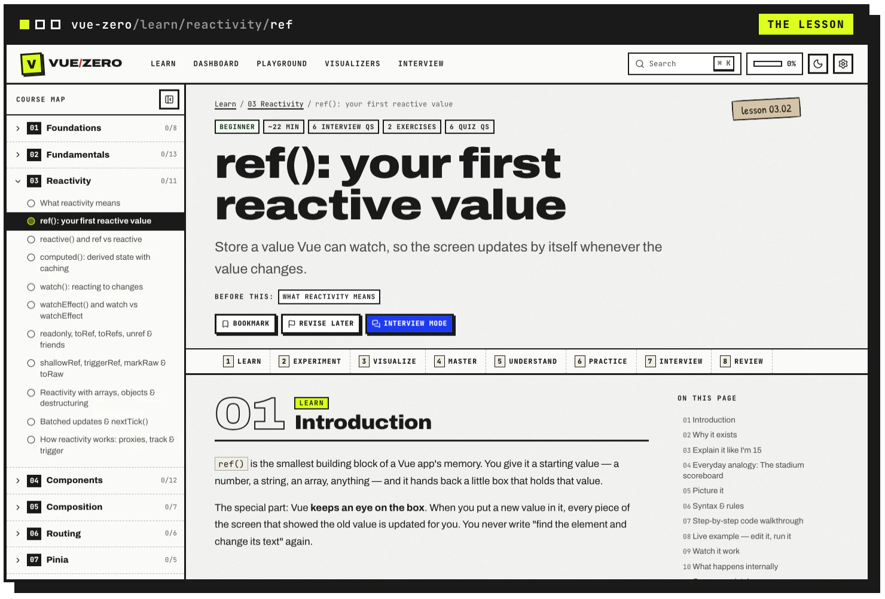
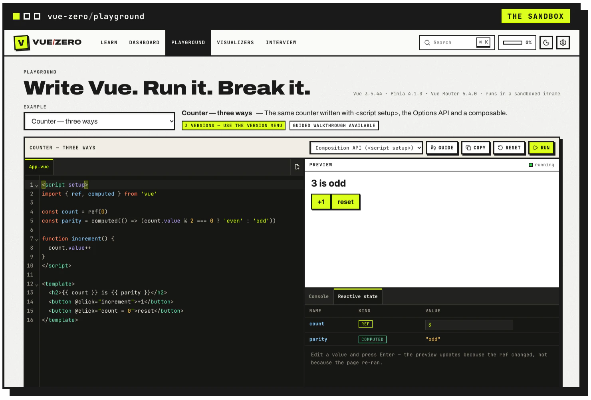
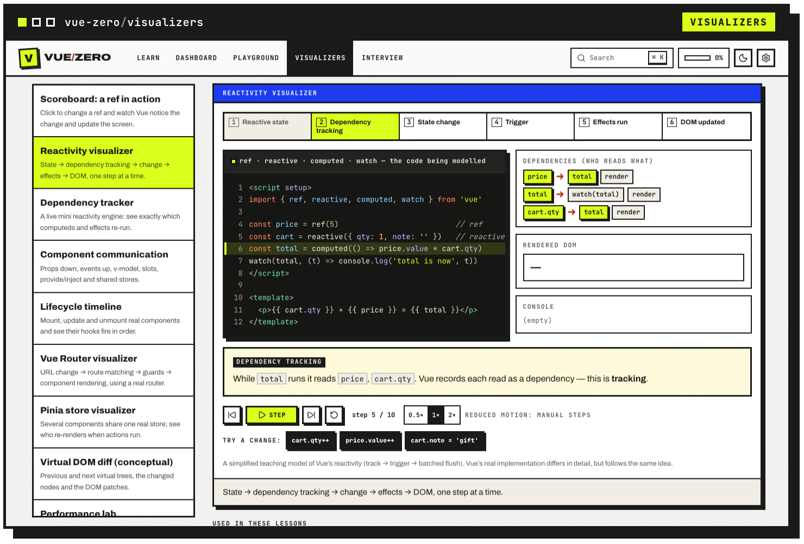
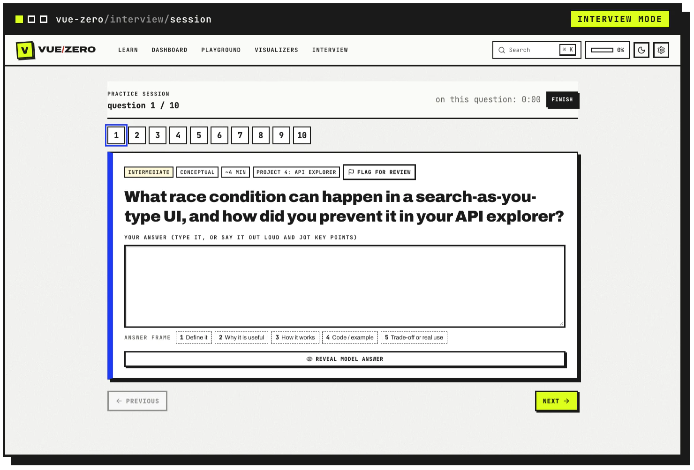
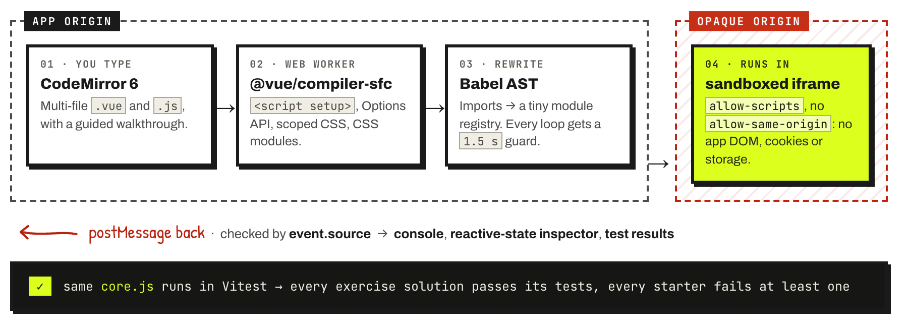

<picture>
  <source media="(prefers-color-scheme: dark)" srcset=".github/readme/hero-dark.webp">
  
</picture>

<p align="center">
  
  
  
  
  
  
  
</p>

<p align="center">
  <b>An interactive Vue.js course built <i>with</i> Vue 3.</b><br>
  From “what is a website?” to SSR and system-design interviews: plain-English lessons, a live code sandbox,<br>
  animated visualizers, quizzes, test-graded exercises and interview practice. No account, no backend.
</p>

<p align="center">
  <a href="#quick-start"><b>Quick start</b></a> ·
  <a href="#learn-it-break-it-explain-it">How lessons work</a> ·
  <a href="#20-levels-one-map">The course map</a> ·
  <a href="#see-it-running">Screenshots</a> ·
  <a href="#a-playground-that-actually-runs">The sandbox</a> ·
  <a href="CONTENT_GUIDE.md">Write a lesson</a>
</p>

<br>

## What's inside

| In the box | Details |
|---|---|
| **134 lessons** | 125 lessons and 9 guided projects across 20 levels |
| **905 interview questions** | 135 of them are coding challenges graded by real tests |
| **905 quiz questions** | multiple choice, predict the output, find the bug, fill the blank, short answer |
| **258 coding exercises** | exercises and project builds, all graded by tests in the browser |
| **500 playground experiments** | guided "change this and see" steps, 412 of them checked automatically |
| **15 visualizers** | driven by real Vue, Vue Router and Pinia instances (or a small, clearly labelled teaching engine) |

The visual style is a raw, editorial, hand-made manual (*Anti-Polish* / neo-brutalist): paper, ink, kraft tape and one acid highlighter, with a dark "blackboard" theme.

<br>

<sub><code>01 — HOW EVERY LESSON WORKS</code></sub>

## Learn it. Break it. Explain it.

Every lesson runs the same loop, and completion is tied to real activity: you have to run the example, pass the quiz and pass an exercise's tests.

<picture>
  <source media="(prefers-color-scheme: dark)" srcset=".github/readme/journey-dark.webp">
  
</picture>

- **A real sandbox.** Single-File Components compile in a Web Worker and run in a sandboxed iframe, with a console, a live reactive-state inspector, guided walkthroughs and in-browser tests.
- **Visualizers you can step through.** Change a value and watch dependency tracking, triggers, effects and DOM updates happen one step at a time.
- **Interview mode.** Practice or timed mock sessions. Answers are auto-graded, test-graded or self-assessed (always labelled), followed by a review screen and a revision queue.
- **Progress stays in your browser.** No account: streaks, quiz history, bookmarks and recommendations live in `localStorage`.

<br>

<sub><code>02 — THE LEARNING PATH</code></sub>

## 20 levels. One map.

<picture>
  <source media="(prefers-color-scheme: dark)" srcset=".github/readme/map-dark.webp">
  
</picture>

<details>
<summary><b>See every level</b></summary>

<br>

| # | Level | Lessons | Band |
|:-:|---|:-:|---|
| 01 | Web & JavaScript Foundations | 8 | beginner |
| 02 | Vue.js Fundamentals | 13 | beginner |
| 03 | The Reactivity System | 11 | beginner |
| 04 | Vue Components | 12 | intermediate |
| 05 | Composition API & Reusable Logic | 7 | intermediate |
| 06 | Routing with Vue Router | 6 | intermediate |
| 07 | State Management with Pinia | 5 | intermediate |
| 08 | Forms & Validation | 4 | intermediate |
| 09 | API Integration & Async Work | 7 | intermediate |
| 10 | Advanced Templates & Rendering | 10 | advanced |
| 11 | Advanced Reactivity & Internals | 5 | advanced |
| 12 | Performance Optimization | 6 | advanced |
| 13 | Testing Vue Applications | 5 | advanced |
| 14 | Styling, UI Architecture & Accessibility | 6 | intermediate |
| 15 | Vue Project Architecture | 5 | advanced |
| 16 | Security & Production Readiness | 4 | advanced |
| 17 | SSR & the Vue Ecosystem | 4 | advanced |
| 18 | TypeScript & Vue *(optional track)* | 3 | intermediate |
| 19 | Real-World Vue Projects | 9 | intermediate |
| 20 | Vue.js Interview Preparation | 4 | advanced |

The source of truth is [`src/content/curriculum.js`](src/content/curriculum.js).

</details>

<br>

<sub><code>03 — SEE IT RUNNING</code></sub>

## See it running

<table>
  <tr>
    <td width="50%" valign="top">
      <picture>
        <source media="(prefers-color-scheme: dark)" srcset=".github/readme/screen-lesson-dark.webp">
        
      </picture>
      <p><b>The lesson.</b> Eight stages from <i>Learn</i> to <i>Review</i>, a course map that fills in as you go, and a “before this” prerequisite.</p>
    </td>
    <td width="50%" valign="top">
      <picture>
        <source media="(prefers-color-scheme: dark)" srcset=".github/readme/screen-playground-dark.webp">
        
      </picture>
      <p><b>The sandbox.</b> Real SFCs, compiled in your browser. The reactive-state inspector shows <code>count</code> as a ref and <code>parity</code> as a computed.</p>
    </td>
  </tr>
  <tr>
    <td width="50%" valign="top">
      <picture>
        <source media="(prefers-color-scheme: dark)" srcset=".github/readme/screen-visualizer-dark.webp">
        
      </picture>
      <p><b>Visualizers.</b> Step through what Vue actually does: who reads what, what gets triggered, and when the DOM updates.</p>
    </td>
    <td width="50%" valign="top">
      <picture>
        <source media="(prefers-color-scheme: dark)" srcset=".github/readme/screen-interview-dark.webp">
        
      </picture>
      <p><b>Interview mode.</b> Answer first, reveal the model answer when you choose, and flag anything you want to see again.</p>
    </td>
  </tr>
</table>

<sub>Screenshots follow your GitHub theme: switch to dark mode to see the blackboard theme.</sub>

<br>

<sub><code>04 — RUN IT LOCALLY</code></sub>

## Quick start

Requires **Node 20.19+** (an `.nvmrc` pins Node 24).

```bash
nvm use            # or any Node >= 20.19
npm install
npm run dev        # → http://localhost:5173
```

| Script | What it does |
|---|---|
| `npm run dev` | Vite dev server |
| `npm run build` / `npm run preview` | production build / serve it |
| `npm test` | all unit, sandbox and content tests (Vitest + jsdom) |
| `npm run validate:content` | content validation only; `LESSONS=ref,computed npm run validate:content` limits it |
| `npm run test:e2e` | Playwright end-to-end and axe accessibility tests (uses your installed Chrome) |

<br>

<sub><code>05 — UNDER THE HOOD</code></sub>

## A playground that actually runs

<picture>
  <source media="(prefers-color-scheme: dark)" srcset=".github/readme/sandbox-dark.webp">
  
</picture>

1. Files are compiled in a **Web Worker** with `@vue/compiler-sfc` (script setup, Options API, scoped CSS, CSS modules, `v-bind()` in CSS).
2. Each module's ES imports and exports are rewritten (via Babel's AST) into a tiny registry format. `import()` works for lazy routes, and every loop gets a guard that throws after 1.5 s instead of freezing the tab.
3. The result runs in an `<iframe sandbox="allow-scripts allow-modals allow-forms">` **without** `allow-same-origin`, so learner code has an opaque origin: no access to the app's DOM, cookies or storage. Messages are checked by `event.source`.
4. The same `core.js` runs in Vitest, which is how the test suite proves that **every exercise solution passes its tests and every starter fails at least one**.

> [!NOTE]
> No Content-Security-Policy header is set: `srcdoc` iframes inherit the parent's CSP, and the sandbox needs inline scripts and `new Function`. Isolation comes from the opaque-origin sandbox instead.

<br>

<sub><code>06 — THE STACK</code></sub>

## Tech stack

| Layer | Tools |
|---|---|
| App | Vue 3.5 (`<script setup>`, JavaScript), Vite, Vue Router, Pinia |
| Editor | CodeMirror 6, with Lezer for static highlighting |
| Motion & icons | GSAP (two meaningful animations only), lucide icons |
| Type | self-hosted Archivo, JetBrains Mono and Patrick Hand |
| Tests | Vitest + Vue Test Utils, Playwright + axe-core |

<details>
<summary><b>Project structure</b></summary>

```text
plugins/
  content-index.js      Vite plugin: builds virtual modules from the lessons
                        (light index · lazy search index · question bank · question meta)
  sandbox-libs.js       serves/emits the Vue, Pinia and Vue Router browser builds the sandbox loads
src/
  content/
    curriculum.js       the course map (20 levels, teaching order)
    lessons/<level>/<lesson>.js   one pure-data module per lesson
    schema.js           content validator (used by tests)
    visualizers.js      visualizer catalog (types + props)
    playground-examples.js, interview-categories.js
  services/
    sandbox/            compile.js (SFC → modules, loop guards, import rewriting),
                        compiler.worker.js, core.js (module registry + test harness,
                        shared by the iframe and Vitest), runtime.js (iframe glue), srcdoc.js
    storage.js          persistence adapter (localStorage today, swappable)
    highlight.js        static highlighting with the editor's Lezer parsers
  stores/               progress, interview, preferences, ui (Pinia)
  utils/                learning analytics, grading, markdown, search, dates,
                        miniReactivity (visualizer engine), vdomDiff
  composables/          useSandbox, useStepPlayer, usePersistedState, useMediaQuery, …
  components/
    layout/ ui/ code/ learning/ quiz/ interview/ diagrams/
  pages/                every route is lazy-loaded
  styles/               tokens.css (design tokens) · base · components · code
tests/
  unit/                 utils, stores, components, router, sandbox, content validation
  e2e/                  learning flow, interview, search, mobile nav, 404, axe (light + dark)
```

</details>

<br>

<sub><code>07 — CONTRIBUTING</code></sub>

## Writing content

Read **[CONTENT_GUIDE.md](CONTENT_GUIDE.md)**, the full authoring contract: schema, teaching standard, accuracy rules, sandbox limits, test API and visualizer catalog. [`src/content/lessons/reactivity/ref.js`](src/content/lessons/reactivity/ref.js) is the reference lesson.

> [!TIP]
> A lesson is done when `LESSONS=<id> npm run validate:content` is green. In dev, the course map and search update automatically when lesson files change (set `VLP_NO_CONTENT_RELOAD=1` to stop open pages reloading during bulk edits).

<br>

<sub><code>08 — THE DETAILS</code></sub>

## Progress and data

Stored in `localStorage` under `vlp:*` (see `services/storage.js`). Stores talk to an adapter with `read/write/remove/keys/subscribe`, so a backend can replace it later. *Settings → Your data* exports and imports JSON and resets data, with confirmation. Completion requires real activity (run the example, pass the quiz on first tries, pass an exercise's tests). Self-assessed answers are never counted as correct.

## Accessibility

Semantic landmarks, a skip link, visible focus rings, keyboard-operable tabs, palette and visualizer controls, native `<dialog>` modals, `aria-live` feedback and text descriptions for every visual. `prefers-reduced-motion` is respected, plus an in-app motion setting (visualizers switch to manual stepping), and there are light and dark themes. The axe suite checks 8 key pages in both themes for serious or critical WCAG 2.1 AA issues.

## Deployment

`vercel.json` configures the Vite build, SPA rewrites, long-term caching for hashed assets and the sandbox libraries, and basic security headers. Any static host works if unknown paths fall back to `index.html`.

## Known limitations

- The sandbox has no npm packages (only `vue`, `pinia`, `vue-router`) and no real network; API lessons use simulated servers. TypeScript and tooling code (Vitest, Playwright, Nuxt, Axios) is shown as static code.
- Sandbox imports are copies, not live bindings (`export let` won't update importers), and top-level `await` isn't supported.
- `localStorage` inside the sandbox is in-memory and resets on each run.
- The search index (about 370 KB gzipped) and question bank (about 600 KB gzipped) load lazily, the first time you search or open interview pages.
- A few time-based project tests (e.g. the simulated real-time socket) assume normal machine load. They pass reliably on their own but can flake when the machine is heavily loaded.

<br>

<p align="center">
  
  <br>
  <b>NO MAGIC. JUST JAVASCRIPT.</b>
  <br>
  <sub><i>made of paper, ink &amp; reactive state ✎</i></sub>
</p>
